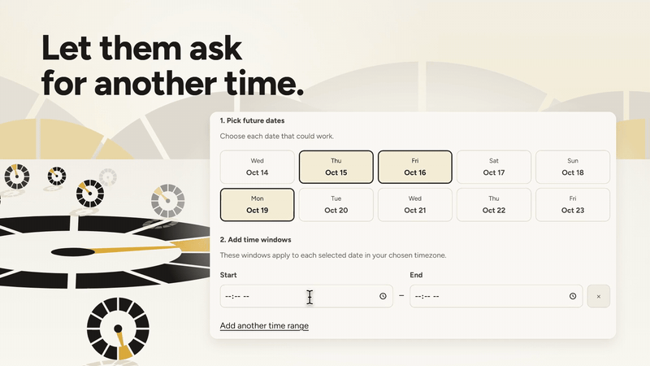
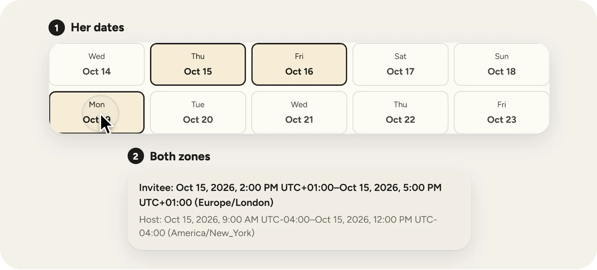
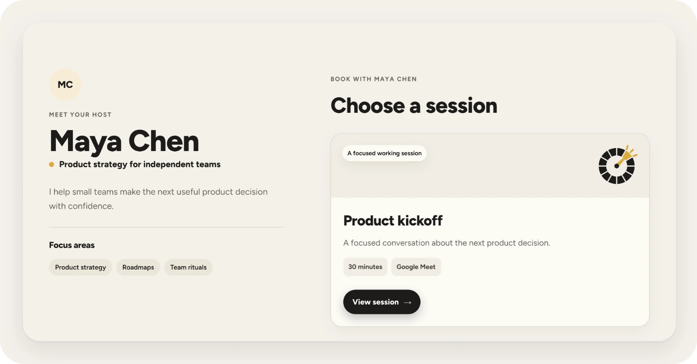
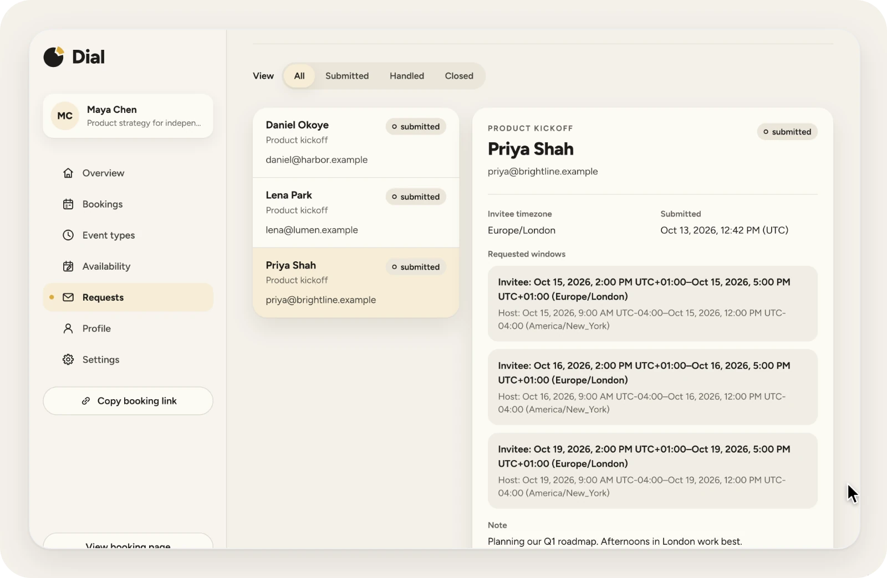
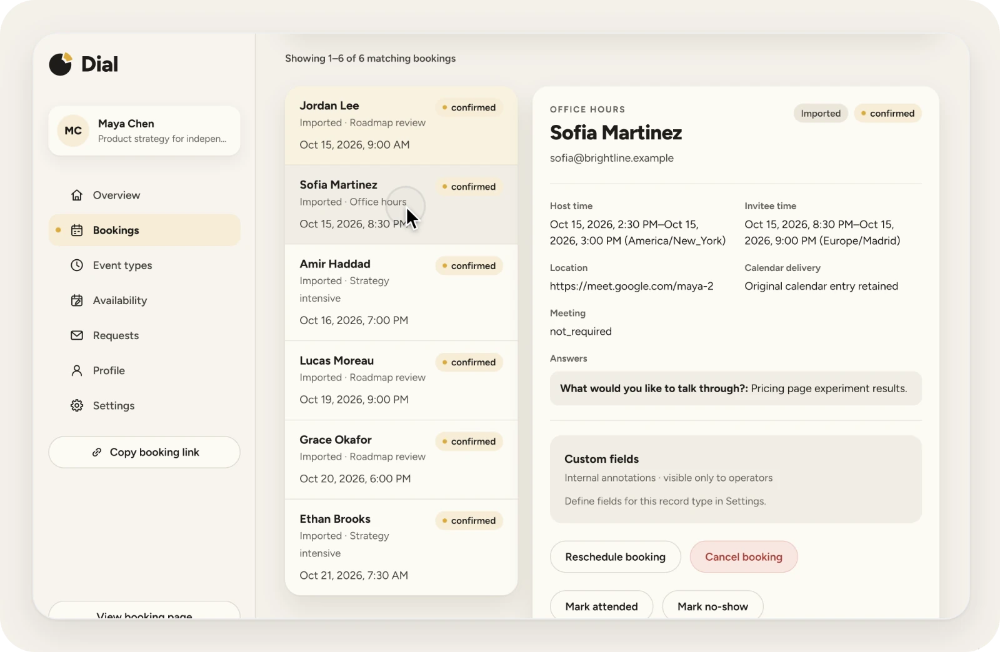

<p align="center">
  <a href="https://run-dial.com">
    <picture>
      <source media="(prefers-color-scheme: dark)" srcset=".github/assets/banner-dark.webp">
      <source media="(prefers-color-scheme: light)" srcset=".github/assets/banner-light.webp">
      
    </picture>
  </a>
</p>

<p align="center"><a href="https://run-dial.com">run-dial.com</a> · <a href="https://justevery.com">Part of Just Every</a> · <a href="LICENSE">MIT licensed</a></p>

<p align="center">
  <a href="https://justevery.com/#vol-dial"></a>
</p>
<p align="center"><a href="https://justevery.com/#vol-dial"><b>Watch the full demo</b></a> · 44 seconds</p>

<p align="center">
  
</p>

<p align="center">
  <br>
  <sub>A public booking page for each host: no account needed to book or ask.</sub>
</p>

<p align="center">
  <br>
  <sub>The host sees every requested window in both time zones.</sub>
</p>

<p align="center">
  <br>
  <sub>Moving from Calendly brings your bookings with you.</sub>
</p>

# Dial

Dial is a self-hosted scheduler for one business or independent host. Invitees
book available time, manage a booking through its private link, or ask the host
for another window. Operators manage event types, availability, bookings,
requests, and calendar connections.

Public source: [just-every/run-dial](https://github.com/just-every/run-dial), release 0.1.0.
Licensed under the [MIT License](LICENSE).

## Run it on your computer

1. Clone the source with `git clone https://github.com/just-every/run-dial.git dial` and
   `cd dial`. Use Node **22.20.0** and pnpm **10.12.4**. Install the locked dependencies:
   `node scripts/rer.mjs install`. `pnpm install --frozen-lockfile` is the
   equivalent package-manager command. Dependency builds are limited to esbuild
   and workerd.
2. Check this first-party declaration with
   `node scripts/rer.mjs check --profile first-party`.
3. Set up the real owner using
   `node scripts/rer.mjs setup --owner-email you@example.com`, or run
   `node scripts/rer.mjs setup` and answer the owner prompt. Use an address you
   can access. For automation, supply the owner explicitly and add
   `--non-interactive`.
4. Start `node scripts/rer.mjs dev`. After health checks it prints
   `RER_READY`, `RER_SIGNED_IN EMAIL` and `RER_OPEN URL`. Open that URL on this
   computer and Dial opens signed in as the owner, in the authenticated `/setup`
   workspace on a fresh install. `RER_OPEN` carries this checkout's local dev
   key in its fragment, which the page trades for a cookie: treat the line as a
   credential and do not share it. `dev --as co-host` starts as the dev
   co-host (a second operator, `co-host@dev.localhost`) and `dev --as
   signed-out` starts as a visitor; the badge on every page switches between
   them. `dev --login` turns dev identity off and prints `RER_SIGN_IN` and
   `RER_OPEN` for the real email-link path: open the outbox, choose the newest
   sign-in message, and follow its link. No email is sent. Sign-in forms work
   before JavaScript hydration. To request a fresh one-use link while the app is
   running, use `node scripts/rer.mjs outbox --owner-email EMAIL`.
5. Stop dev with `node scripts/rer.mjs dev --stop` (or Ctrl-C) before
   `node scripts/rer.mjs verify`. Stop preview with
   `node scripts/rer.mjs preview --stop` before changing modes, building,
   verifying, resetting, or moving data.

Setup builds and migrates the app, prepares its real first owner, requests an
ordinary sign-in message, then exits with no app running. Repeating setup keeps
the saved owner, domain data, and private settings; a conflicting owner or
origin is refused. There is no automatic owner or secret rotation.

## First-run workspace setup

In `/setup`, save the real host profile, check the configured mail sender, and
publish an eligible event or choose Open requests. Open requests requires a
working mail sender but does not require Google Calendar or availability
windows. Copy the canonical booking link, then select **Finish setup**; Dial
rechecks the relevant current connections and opens `/app`. Unfinished `/app`
documents return to `/setup`, while completed owners are sent to `/app`.
Connection-health changes, profile/event edits or deletion, and operator removal
or reinvitation do not reopen completed setup. Current archives preserve its
completion marker; confirmed reset and fresh setup leave the new owner pending.
Upgraded existing owners retain their prior creation time as compatibility
metadata, not as evidence that historical setup actions occurred.

## Local runtime and data

Dev serves source edits through Vite HMR. Run `node scripts/rer.mjs preview`
to serve the fixed production Worker and assets. Both are managed foreground
servers on loopback, share the same owner and durable data, and print readiness
only after health and outbox checks pass. Compatible repeat starts reuse the
registered server. Use
`--idle-timeout SECONDS` to change its inactivity limit, and `--port PORT` to
choose an available loopback port.

`rer dev` runs Dial's deployed Cron schedule (every minute) on its minute and
prints one `RER_SCHEDULED TIME "* * * * *" ok MSms` line per run. Each run is the
deployed scheduled pass: connection checks and alerts, calendar sync and channel
renewal, then due reminders and mail or calendar retries. The root
`wrangler.jsonc` repeats the template's `triggers.crons` because rer reads its
schedule only from that file; rendering refuses (so build, setup and verify fail)
when the two differ. `rer preview` still runs no schedule. With no calendar
connected the pass has no bookings to remind or retry, since publishing needs a
checked destination calendar; the journey `node scripts/verify-lifecycle-journey.mjs`
proves reminders, retries, alerts and sync on this schedule against synthetic
provider HTTP. See [OPERATIONS.md](OPERATIONS.md).

The browser installer and Base's sign-in confirmation page wear Dial's look through one file, `public/rer-theme.css` (the landing's paper, ink and
Figtree, and the Dial mark). The Worker serves it with the font and mark it names; the installer descriptor and the operator-auth branding both
declare it, and the installer refuses a theme that breaks Base's grammar or contrast rules.

Private settings live in `.dev.vars` with mode `0600`; canonical D1 and R2 state
lives in `.wrangler/state`; private installer captures live in
`.seed/installer`. The checkout's dev key lives in `.rer/local/dev-key.env`
(mode `0600`); `rer setup` creates it and `rer reset --yes` removes it. The
local outbox at `/__dev/outbox`, dev sign-in and the personas answer only a
local runtime that holds the key and a request that presents it, so a tunnel or
local proxy that forwards to the loopback port gets 404. The outbox retains up to
100 messages for seven days. Anyone with access to the local account can read it.
Dev sessions and personas never reach a deployment or an export: `rer build`
refuses output that bundles the dev layer and `rer deploy` refuses the key.

`node scripts/rer.mjs reset --yes` removes only the inventoried local runtime
state, CLI bookkeeping, installer state, and generated private settings. Stop
all RER processes first. Reset refuses active operations and unsafe or
ambiguous state; it preserves source, dependencies, `exports/` archives, and
`.rer/deploy/` receipts. Export anything needed before resetting. A fresh setup
then starts an empty local installation. Reset does not delete deployed
Cloudflare resources.

## Export and restore

Stop dev or preview before data movement. Export to a new archive path under
`exports/`:

```sh
node scripts/rer.mjs export --output exports/dial.rer
```

The owner-only JSON-lines archive includes Dial's durable database records and
the original R2 objects with their metadata. It preserves durable owner and
booking facts while excluding private credentials, sessions, sign-in and invitation
links, booking capabilities, OAuth credentials, webhook authority, development
mail, and pending admissions. The private `SESSION_SECRET` is never exported;
its non-secret continuity hash protects restored retry and erasure guards.
Export refuses to overwrite an existing archive. Remote transfer is unsupported
and fails before provider calls.

Restore only to an empty destination. Keep a private copy of the original
`.dev.vars`; after a reset or on a new machine, restore those settings securely
with the same `SESSION_SECRET` before importing. Do not run setup first, because
that creates an owner and makes the destination nonempty:

```sh
node scripts/rer.mjs import --input exports/dial.rer --yes
node scripts/rer.mjs setup --owner-email you@example.com
```

Import applies the local migrations, validates the complete archive and schema,
then restores through Base portability. D1 and R2 have no shared transaction;
if a restore fails or is interrupted, leave that destination unpublished and
recover there or use another clean destination. After restore, sign in with a
fresh link, reconnect Google Calendar, and recheck mail. Export again and
compare the `contentHash` to confirm round-trip equivalence.

For old `dial-export.v2` archives, use the original revision to restore into an
isolated installation, then export with the current command. Existing migration
files are preserved byte for byte.

## Deploy and release

`node scripts/rer.mjs deploy --dry-run` builds and validates locally without
provider requests. A real deployment is a separate owner-account operation:
`node scripts/rer.mjs deploy --environment production`. It requires the
configured Cloudflare account and production secrets. Local checks and the dry
run do not establish remote health, email delivery, Google Calendar access, or
production acceptance.

`node scripts/rer.mjs release --repo PATH --output PATH` creates the declared
local release artifact and receipt. It does not push, publish, or deploy. No
tag, public publication, or production deployment is claimed here.

## Product and development references

The product requirements are in [CONTRACT.md](CONTRACT.md), shared security and
privacy requirements in [BASELINE.md](BASELINE.md), and local, restore, and
deployment procedures in [OPERATIONS.md](OPERATIONS.md). The supported command
flags and effects are in [SEED-COMMAND-CONTRACT.md](SEED-COMMAND-CONTRACT.md).
That contract and [RUN-LOCALLY.md](RUN-LOCALLY.md) are unchanged Base guides.
Archives live under the checkout's unserved `exports/` or at an absolute path
outside the checkout; the CLI refuses any other location (see the
[Dial commands above](#export-and-restore)).
[HANDOVER.md](HANDOVER.md) records what remains unverified. The synthetic
`pnpm run review` runtime is isolated from the real local owner and provider
configuration.

The full `verify` target runs lint, boundary and contract checks,
typechecking, the test suite, migration validation, a production build, and
Base copy verification. The browser suite includes a fresh local clone of the
public CLI journey at 1440 and 390 pixel widths, with setup, pre-hydration
sign-in, reset, export/import, and preview. Generated evidence goes outside the
checkout by default, and the run checks that tracked inputs were not changed.
Synthetic providers are confined to tests and the separate review runtime;
these checks do not prove live provider access or deployment acceptance.

Useful read-only commands are `node scripts/rer.mjs describe`, `doctor`, and
`check --profile first-party`. Describe reports the current checkout's actual
commands, flags, aliases, pins, and effects. Check validates the declared
contract; doctor inspects local tools and configuration. Neither proves app
acceptance, remote deployment, or live provider health.

For package-script forwarding, use `pnpm run VERB -- FLAGS`; in particular,
`pnpm run deploy -- --dry-run` selects Dial's deploy command. `pnpm deploy` is
pnpm's built-in dependency command.

Move an existing schedule with the [saved-data importing guide](docs/importing.md).
